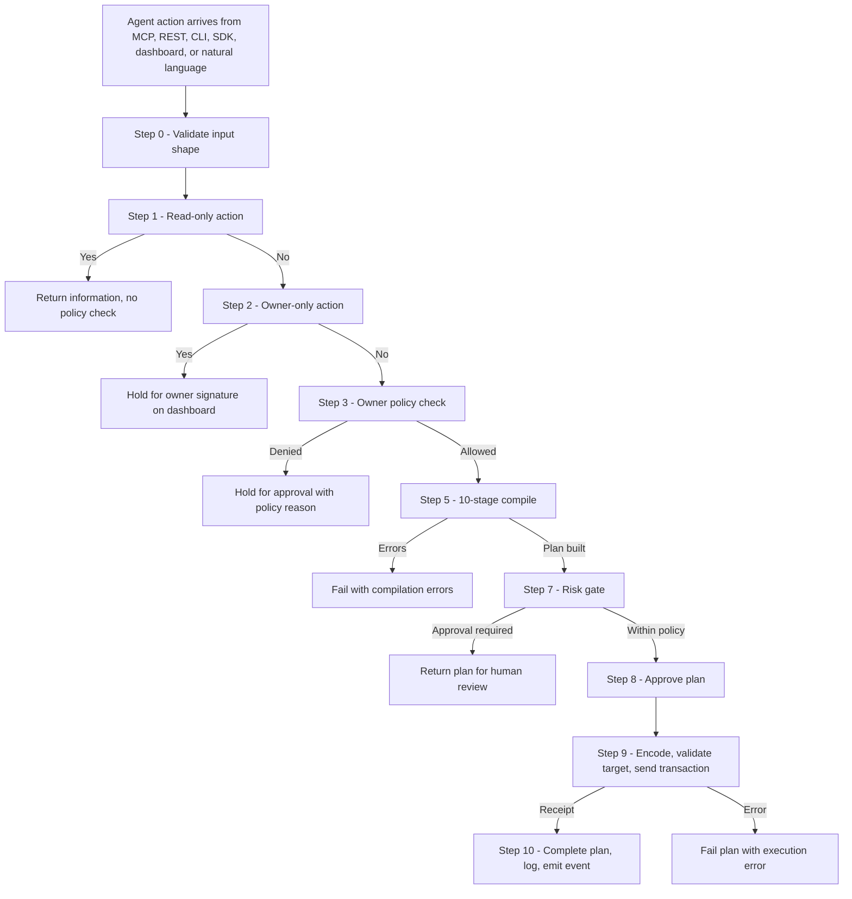
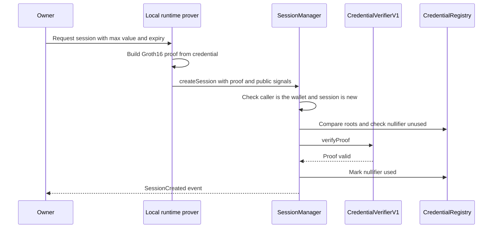
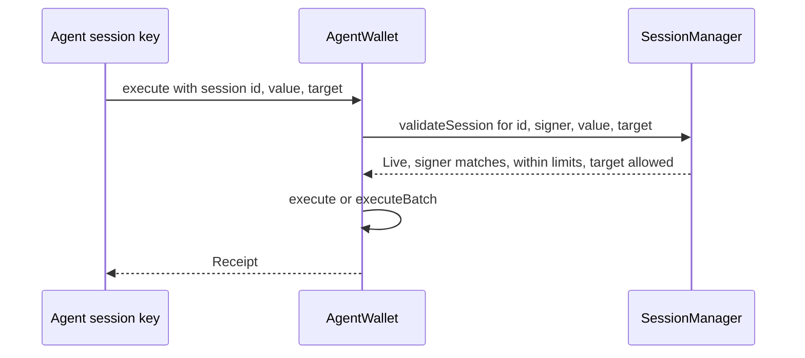
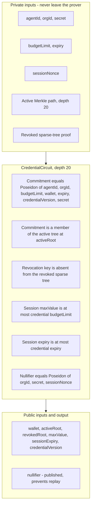
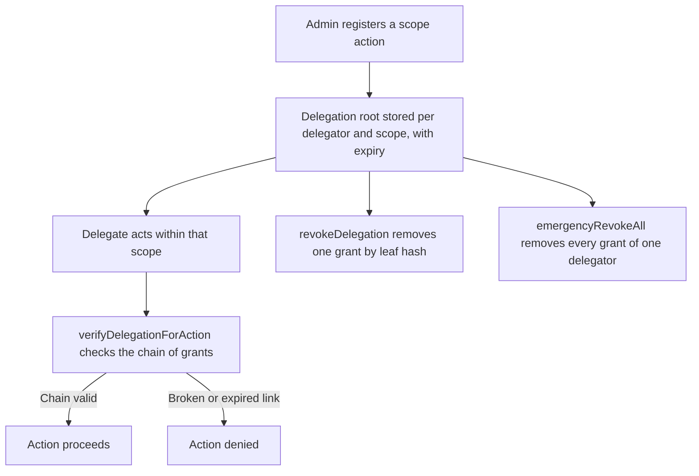
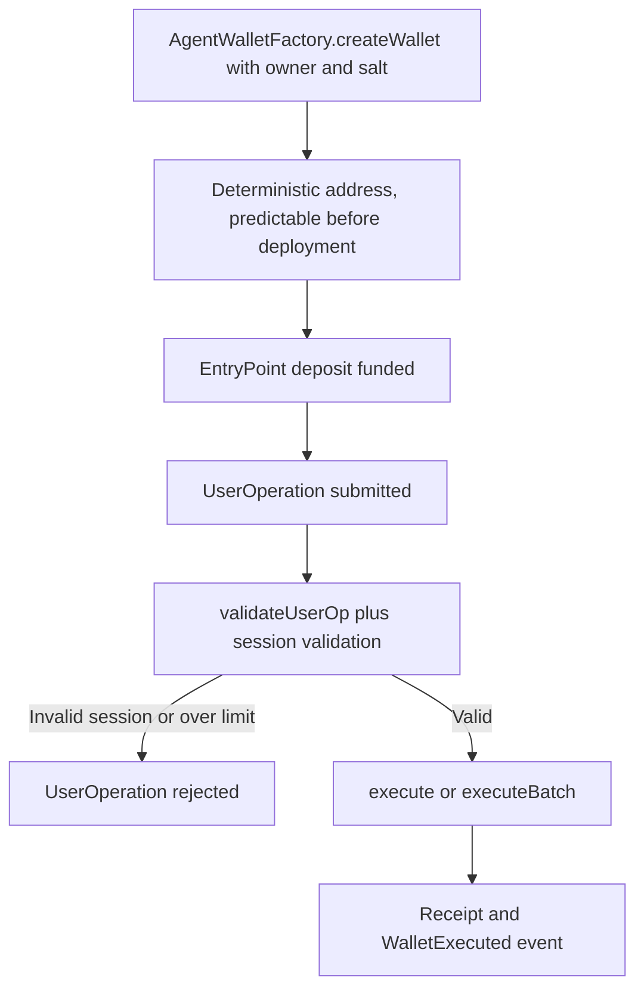
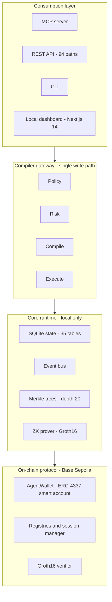

# AGENTIX — Local-first credential runtime for AI agents

> An AI agent with a wallet and no bounds is a liability. AGENTIX is the layer that gives it bounds: credentials, sessions, budgets, and a risk check on every action — before anything touches the chain.

[](https://github.com/SRIVISHNUGV-DEV/AGENTIX/actions)
[](LICENSE)
[](https://bun.sh)
[](https://www.typescriptlang.org/)
[](https://soliditylang.org/)
[](https://sepolia.basescan.org/)
[](docs/SECURITY.md)

---

AI agents already act: they call tools, move funds, and sign things. The infrastructure around them was built for humans — a person approves, a person holds the key, a person notices when something looks wrong. Give an agent a raw private key and a standing permission and you get the worst of both worlds: machine speed with no governor.

**AGENTIX is that governor.** A local-first runtime where an agent gets a smart wallet, a credential, and a session — and every action it proposes is validated, simulated, risk-scored, and explained *before* it executes. Nothing runs on ambient authority. Nothing runs on a standing key.

> An agent proposes a swap that would drain its budget. AGENTIX checks its credential, confirms the session is live, finds the spend limit exceeded, and denies the action with a reason — before any signature is produced. A different action, inside budget and inside scope, passes the same gates, gets simulated, scored low-risk, explained in plain terms, and only then executes.

**One command starts the whole thing:**

```bash
cd agentix && bun install && bun run build && bun x tsx src/index.ts init && bun run serve
```

---

> [!WARNING]
> **Read this first — honest status, not marketing.**
>
> - **Stale, not production.** The last upstream commit is July 2026. This repository is kept neat and findable; it is not a maintained product, and nothing here should be presented as one.
> - **Testnet only.** Contracts live on Base Sepolia. Addresses are in [`contracts/deployments/baseSepolia-84532.json`](contracts/deployments/baseSepolia-84532.json).
> - **Unaudited.** The contracts have no independent professional security audit. See [`docs/SECURITY.md`](docs/SECURITY.md) before putting anything of value near them.
> - **Local trust only.** The runtime API binds to `127.0.0.1` and has no authentication — it trusts every local caller. Never expose it to a network.

---

## Contents

- [The model in one table](#the-model-in-one-table)
- [How it works](#how-it-works)
  - [The gateway: every action passes through one door](#the-gateway-every-action-passes-through-one-door)
  - [The 10-stage compiler](#the-10-stage-compiler)
  - [Sessions: two ways to be allowed](#sessions-two-ways-to-be-allowed)
  - [Credentials and the ZK circuit](#credentials-and-the-zk-circuit)
  - [Delegation](#delegation)
  - [Wallet execution](#wallet-execution)
  - [Where state lives](#where-state-lives)
  - [How agents connect](#how-agents-connect)
- [Architecture](#architecture)
- [Contracts on Base Sepolia](#contracts-on-base-sepolia)
- [Layout](#layout)
- [Run it](#run-it)
- [Development and CI](#development-and-ci)
- [Security](#security)
- [What this is not](#what-this-is-not)
- [License](#license)

---

## The model in one table

For any agent action, AGENTIX answers six questions — and a "no" anywhere stops the action with a reason, not a silent failure.

| Question | Answered by |
|---|---|
| **WHO** can act? | Credentials and on-chain identity |
| **WHAT** can they do? | Capabilities and permissions |
| **WHEN** can they do it? | Sessions and expiry |
| **HOW MUCH** can they spend? | Budgets and spend limits |
| **FOR HOW LONG** can they operate? | Time bounds |
| **UNDER WHAT CONSTRAINTS** can they execute? | Policies and scope |

---

## How it works

Everything below is how the code actually runs — gateway, compiler, contracts, and circuit, in the order an action travels through them. File paths are given so you can check each claim against the implementation.

### The gateway: every action passes through one door

All entry points — MCP, REST, CLI, SDK, dashboard, and natural-language intent — funnel into one class: the compiler gateway (`agentix/src/compiler-gateway.ts`, method `executeIntent`). There is no second path to the chain. An action travels these steps, in order:

0. **Input guard.** Non-string actions and non-object params are rejected with a clean error instead of crashing deeper in the pipeline.
1. **Read-only actions skip the policy check.** Queries return information; they move no value, so they do not need permission.
2. **Owner-only actions always require approval.** Creating a wallet, transferring wallet ownership, registering or deactivating an organisation, and registering a capability can never auto-execute — the gateway returns them for a human to sign on the dashboard.
3. **Owner policy check.** For anything else, the wallet's owner policy is checked: allowed and forbidden actions, daily limits, per-transaction limits. A policy denial returns the policy's reason, and the plan is held for approval rather than executed.
4. **Contract addresses load from config.** The gateway resolves the factory, wallet, session manager, credential registry, organisation registry, capability registry, delegation manager, and identity contracts it will talk to.
5. **Compile through the 10-stage pipeline** (next section). Compilation errors stop the action here.
6. **Log the intent** as compiled, with its plan id, value, target, and risk score.
7. **Risk gate.** If the plan's risk assessment requires approval, the plan is returned for human review instead of executing.
8. **Auto-approve within-policy plans.** Only plans that passed policy and risk get approved, and approval is an explicit step, not a default.
9. **Execute on-chain.** The action is encoded into address-validated, ABI-encoded calldata — the encoder resolves the target through a proxy guard and asserts the target is actually deployed on this chain before anything is signed — then sent with the runtime signer, and the receipt's transaction hash is captured.
10. **Complete or fail the plan**, log the outcome, and emit a `WalletExecuted` event on the event bus.



<details>
<summary>Which actions skip the policy check, and which always need the owner</summary>

**Read-only, no policy check** (from the gateway source): `wallet_info`, `wallet_list`, `wallet_balance`, `session_validate`, `session_list`, `session_get`, `session_status`, `credential_get`, `credential_list`, `credential_verify`, `organization_get`, `organization_list`, `capability_list`, `delegation_list`, `tree_status`, `proof_list`, `proof_verify`, `identity_lookup`, `identity_get`.

**Always require owner approval**: `wallet_create`, `wallet_transfer_ownership`, `organization_register`, `organization_deactivate`, `capability_register`.

When no owner policy is set, the defaults are narrow: the only allowed action is `wallet.execute`, and `changeOwner` and `upgradeImplementation` are forbidden.
</details>

### The 10-stage compiler

Compilation is not one function — it is a pipeline (`agentix/packages/compiler/pipeline/stage-1-intent-parser.ts` through `stage-10-plan-generator.ts`), plus a natural-language intent parser for plain-English requests. Each stage feeds the next, and the plan that comes out carries its own risk score, explanation, and approval state.

| Stage | What it does |
|---|---|
| 1. Intent parser | Normalises the incoming action and parameters into a structured intent |
| 2. Validator | Rejects malformed or impossible intents before any policy work happens |
| 3. Capability resolver | Works out which capabilities the intent needs |
| 4. Policy generator | Builds the policy the intent must satisfy |
| 5. Policy optimizer | Simplifies the generated policy |
| 6. Contract resolver | Maps the intent to the contracts and functions it will touch |
| 7. Simulator | Simulates the outcome before anything is signed |
| 8. Risk engine | Scores the intent from signals, history, and reputation, and decides whether a human must approve |
| 9. Explanation generator | Writes the plain-language explanation the owner sees |
| 10. Plan generator | Produces the final execution plan, with its id, risk category, and approval state |

Plans are not throwaway objects: they are stored (plan store), listed, approved, rejected, and completed or failed by id, through the gateway and through the API (`/api/plans`, `/api/plans/approve`, `/api/plans/reject`) and the compiler MCP tools.

### Sessions: two ways to be allowed

A session is a bounded permission: a key that may act for one wallet, up to a value, until a time, and no further. AGENTIX has two session kinds, and they exist for different trust levels.

**Standard sessions — ZK proofs.** For high-trust use, the agent proves it holds a valid credential without revealing the credential itself. Creating one (`SessionManager.createSession`) is deliberately strict, and every check below is enforced on-chain, in this order:

1. The caller must be the wallet itself, and the wallet must be a registered `AgentWallet`.
2. The session key must be a real address, different from the wallet.
3. The expiry must be in the future, and the session id must not already exist.
4. The wallet must not already hold the maximum number of sessions.
5. The proof's public signals must match chain state exactly: active root, revoked root, max value, expiry, wallet address, and credential version.
6. The nullifier must be non-zero and never used before — this is what stops a proof being replayed for a second session.
7. The Groth16 proof must verify against the credential verifier contract.

Only then is the session stored (wallet, session key, max value, value used starting at zero, expiry, revoked flag), the nullifier marked used, and a `SessionCreated` event emitted.



**Lightweight sessions — owner signatures.** For lower-trust, faster use, no ZK proof is needed. The wallet owner signs a message covering the chain id, session manager, wallet, session id, session key, daily spend limit, daily transaction limit, expiry, and allowed target list — and `createLightweightSession` recovers the signer from that signature and requires it to be the wallet's owner. The session then enforces its own daily counters: daily spend used and daily transaction count used, reset once per day, plus an allowed-targets list with a maximum length. Both session kinds can be revoked by the wallet (`revokeSession`, `revokeLightweightSession`), and expired sessions can be pruned (`pruneExpiredSessions`).

**Validation at execution time.** Sessions are not just checked at creation. Before an `AgentWallet` executes anything, it calls back into the session manager (`validateSession` / `validateLightweightSession`) with the session id, the signer, the value, and the target — and execution only proceeds if the session is live, the signer matches, the value fits the remaining limit, and the target is allowed. A stolen session key still cannot spend past its limits, and an expired session cannot execute at all.



### Credentials and the ZK circuit

Credentials are issued through organisations, not self-asserted. The organisation owner adds issuers (`CredentialRegistry.addIssuer`); issuers publish two Merkle roots — the **active root** for valid credentials and the **revoked secret root** for revoked ones (`updateActiveRoot`, `updateRevokedSecretRoot`). The session manager is the only other contract authorised to touch the registry, and only to mark nullifiers used. No credential root can be set by an individual without issuer authorisation.

The circuit (`circuits/credential_V1.circom`, Circom 2.1.0, Groth16 over BN128, Merkle depth 20) proves five things at once, without revealing the credential:



| Rule enforced by the circuit | Why it matters |
|---|---|
| Commitment membership in the active tree | Only credentials an issuer actually published can be used |
| Non-membership in the revoked tree, keyed by a 64-bit truncation of the secret hash | A revoked credential cannot produce a valid proof, even with its old data |
| Session max value at most credential budget limit | A session can never be worth more than the credential that backs it |
| Session expiry at most credential expiry | A session cannot outlive the credential that backs it |
| Nullifier uniqueness, enforced on-chain | The same proof cannot mint two sessions |

The verifier contract (`CredentialVerifierV1`) is generated from this circuit, and the seven public signals the chain sees are exactly: active root, revoked root, max value, session expiry, wallet, credential version, and nullifier. Bit-width checks bound every input (128-bit budgets, 64-bit expiries and nonces, 160-bit wallet address, 16-bit credential version).

### Delegation

Delegation is how authority flows downward: a delegator grants a scoped permission, and the grant is recorded as a root the chain can verify, not as a private promise.



Mechanics, from `DelegationManager`: scopes are registered by name by an admin role; each delegator's grants live under a root keyed by delegator plus scope hash, with creation time and expiry; verification walks the chain hop by hop (`verifyDelegation`, `verifyDelegationForAction`, `verifyDelegationChain`); a single grant is revoked by its leaf hash, and an admin can emergency-revoke everything one delegator holds and later re-authorise them. Delegation depth is configurable, with a default maximum chain depth of 5 and a hard maximum of 10 — depth is a safety control, not a feature to maximise, because every extra link is another party that must stay honest for the chain to mean anything.

### Wallet execution

Wallets are ERC-4337 smart accounts, not externally owned accounts with a key lying around. The factory (`AgentWalletFactory`) deploys them deterministically — the address can be predicted from owner and salt before deployment (`getAddress`) — and registers the wallet's on-chain identity (`registerIdentity`). The wallet holds an EntryPoint deposit (`addDeposit`, `getDeposit`, `withdrawDepositTo`) so it can pay for its own user operations.



Sensitive wallet changes are two-step by design, never one transaction: changing the owner, the session manager, the EntryPoint, or the implementation is always propose-then-accept (`proposeSessionManager` / `acceptSessionManager`, and the same pattern for the others). A single compromised transaction cannot repoint a wallet at an attacker's session manager.

### Where state lives

Everything local lives in one place: `~/.agentix`, with the database at `~/.agentix/db/agentix.db` (SQLite via better-sqlite3, 35 tables as reported by the health check). That includes wallets, credentials, sessions, plans, policies, compiled-plan caches, the event log, and the action log — the `agent_actions` table records each action with its plan id, value, target, risk score, and risk category, plus the transaction hash when one exists. The event bus carries runtime events such as `WalletExecuted`. The API's bound port is recorded in `~/.agentix/runtime.json` so the dashboard can discover it without manual wiring. Test runs use a separate database (`.agentix-test/db/agentix.db`), so testing never touches real runtime state.

### How agents connect

**MCP server.** The MCP server speaks the Model Context Protocol and works with any MCP-compatible client (Claude Code, Cursor, VS Code, and others). Its tools are documented in [`agentix/README.md`](agentix/README.md), grouped by category:

| Category | Tools | What they cover |
|---|---|---|
| System | 6 | Health, stats, contracts, diagnostics, RPC test, protocol docs |
| Config | 2 | Get and show configuration |
| Wallet | 6 | Create, list, get, balance, identity, execute |
| Identity | 2 | Get by wallet, get by id |
| Session | 4 | List, validate, find mine, status |
| Organization | 3 | List, get, get anchor |
| Credential | 5 | List, get, history, verify, oracle |
| Capability | 3 | List, get, verify |
| Delegation | 4 | Verify, verify chain, list, get root |
| Trees | 1 | Tree status |
| Proofs | 2 | List, verify |
| Events | 1 | Recent events |
| Logs | 2 | Session logs, log stats |
| Harnesses | 2 | Scan, list |
| Transactions | 2 | List, get |
| Bundler | 5 | Submit, status, flush, address, send |
| Keygen | 1 | Generate agent key pair |
| Onboarding | 2 | Status, fund options |
| Compiler | 5 | Parse intent, compile, get plan, list plans, approve plan |
| Policy | 5 | Get, check, set, capability envelope |
| Dashboard-only | 8 | Blocked for agents — see below |

> [!IMPORTANT]
> **The dashboard-only gate.** Eight operations are blocked for AI agents and require the owner's wallet: `agentix_session_create`, `agentix_session_revoke`, `agentix_session_prune`, `agentix_wallet_execute_batch`, `agentix_config_set`, `agentix_backup_create`, `agentix_policy_set`, and the deprecated `agentix_wallet_whitelist`. Session creation and revocation, batch execution, config changes, backups, and policy changes are owner acts by design — an agent that could grant itself a session or rewrite its own policy would make every other gate meaningless.

**REST API.** The API is a plain Node HTTP server (no framework) bound to `127.0.0.1`, with a 1 MB body cap, CORS open to local origins, and every request body validated against Zod schemas that live in `packages/shared/schemas`. Counting the route strings in `agentix/src/runtime/server.ts` gives 94 distinct `/api/` paths, including: health, runtime info, and stats; onboarding (status, diagnostics, harnesses, fund, init); organisations and their requests; credentials (including oracle, next agent/org ids, root updates); sessions (including prepare and create-transaction endpoints for both lightweight and standard sessions); wallets (create, deposit, EntryPoint deposit, execute, link, whitelist, confirm); delegations; capabilities and the capability envelope; policy and policy checks; plans with approve and reject; execute and execute-plan; compile and debug simulation; proofs (generate, verify, artifacts); Merkle trees (list, export, import, rebuild, snapshots, verify); contract reads, prepared writes, registry, and functions; events and the event indexer (status, run, reindex, reproduce); bundler; backups; actions; anomalies; transactions; identity; config; diagnostics; price; and an x402 payments surface (balance, batch, buy, payments, policy, seller routes and stats, vouchers).

**Dashboard.** A Next.js 14 app served by the runtime, with sections for overview, wallets, sessions, credentials, capabilities, delegations, organisations, identities, transactions, actions, plans, trees, events, anomalies, backups, analytics, diagnostics, developer tools, settings, onboarding, and x402. It discovers the API port automatically from `runtime.json`.

**CLI.** The `agentix` command covers init, setup, connect, health, diagnostics, doctor, config, org, credential, session, wallet, tree, delegation, capability, proof, backup, contracts, RPC connectivity tests, and protocol information — run `bun x tsx src/index.ts --help` for the full list.

---

## Architecture

One system, two layers: a local-first runtime and the on-chain protocol it talks to. There used to be a third layer — a hosted control plane with an Express backend, PostgreSQL, and Redis — but it stopped compiling, was superseded by the runtime, and was deleted in the 2026-10-24 cleanup. It is not coming back.



| Layer | Technology | Purpose |
|---|---|---|
| **Consumption** | MCP server, REST API, CLI, Next.js dashboard | Every way an agent or a human talks to the runtime |
| **Compiler gateway** | TypeScript policy engine | The single write path: Policy → Risk → Compile → Execute |
| **Core runtime** | SQLite, event bus, Merkle trees, Groth16 prover | Local state, history, revocation, and ZK proofs |
| **Protocol** | Solidity 0.8.24, Hardhat | 10 contracts: wallets, credentials, sessions, capabilities, delegation |
| **Circuit** | Circom, Groth16, BN128 | `credential_V1.circom` — Merkle depth 20, 7 public signals |

Full detail lives in [`docs/ARCHITECTURE.md`](docs/ARCHITECTURE.md).

---

## Contracts on Base Sepolia

Deployed July 2026. Addresses below are copied from [`contracts/deployments/baseSepolia-84532.json`](contracts/deployments/baseSepolia-84532.json), which is the canonical record — if any other document in this repo shows a different address, this file wins.

| Contract | Address | Role |
|---|---|---|
| **AgentWallet** | [`0x6C826A49aD8447FD94d61f515013ea93066e94C5`](https://sepolia.basescan.org/address/0x6C826A49aD8447FD94d61f515013ea93066e94C5) | ERC-4337 smart account |
| **AgentWalletFactory** | [`0x6A4C643f59952CfBfEcEdaf182B3C98D778df2c1`](https://sepolia.basescan.org/address/0x6A4C643f59952CfBfEcEdaf182B3C98D778df2c1) | Deterministic wallet deployment |
| **SessionManager** | [`0x9b7B7d631098f046eaFb4637DC859eBA51e238C0`](https://sepolia.basescan.org/address/0x9b7B7d631098f046eaFb4637DC859eBA51e238C0) | ZK and lightweight sessions, spend limits |
| **CredentialRegistry** | [`0xF1C30a96aa97faB2A29B2E8Cdc05fc321AA7511E`](https://sepolia.basescan.org/address/0xF1C30a96aa97faB2A29B2E8Cdc05fc321AA7511E) | Active and revoked credential Merkle roots, nullifiers |
| **CapabilityRegistry** | [`0x90D4d0D35709D4e29765F5132DaD0E85Fc07aD6A`](https://sepolia.basescan.org/address/0x90D4d0D35709D4e29765F5132DaD0E85Fc07aD6A) | Capability definitions and grants |
| **DelegationManager** | [`0x6Ee3cdeB9c1a1aE83CF0bb0E469B98736Cb07CB5`](https://sepolia.basescan.org/address/0x6Ee3cdeB9c1a1aE83CF0bb0E469B98736Cb07CB5) | Delegation chains |
| **OrganizationRegistry** | [`0xdF3e6819fC65966d0D43A3768Aaa40fd50B59443`](https://sepolia.basescan.org/address/0xdF3e6819fC65966d0D43A3768Aaa40fd50B59443) | Organisation onboarding |
| **OrganizationCredentialAnchor** | [`0x491aD666EFb0E79Ce8406a10914033eEdB6165b6`](https://sepolia.basescan.org/address/0x491aD666EFb0E79Ce8406a10914033eEdB6165b6) | Per-organisation trust domains |
| **AgentIdentity** | [`0xaF20A4CF58CF8E3DF6bF2545Ed9371d39E97cD71`](https://sepolia.basescan.org/address/0xaF20A4CF58CF8E3DF6bF2545Ed9371d39E97cD71) | On-chain agent identity |
| **CredentialVerifierV1** | [`0x3056bB17323228d1829D2f6A2a96Af8e079095c2`](https://sepolia.basescan.org/address/0x3056bB17323228d1829D2f6A2a96Af8e079095c2) | Groth16 verifier generated from the circuit |

> [!IMPORTANT]
> These addresses are a testnet deployment record, not a claim of verification or audit. Source verification on Basescan and a professional audit are both absent — see [`docs/SECURITY.md`](docs/SECURITY.md).

---

## Layout

| Path | What it is |
|---|---|
| `agentix/` | **The project.** The runtime: `src/` (core, MCP server, runtime, tools, SDK, blockchain, compiler gateway), `packages/` (shared, core, services, compiler, indexer, scheduler, merkle-tree, agent-manifest), `apps/dashboard/` (local dashboard), `tests/`, `bin/` (CLI entry points). Its own README is [`agentix/README.md`](agentix/README.md). |
| `contracts/` | The protocol contracts (Solidity): credential registry, session manager, capability registry, delegation manager, organisation registry, agent wallet + factory, Groth16 verifier. Tests under `contracts/test/`, deployment scripts under `contracts/scripts/`. |
| `circuits/` | The ZK circuit: `credential_V1.circom` (Groth16, BN128, Merkle depth 20). Build artifacts are generated from source and are not committed. |
| `docs/` | `ARCHITECTURE.md`, `SETUP.md`, `SECURITY.md`, `PROTOCOL_ASSUMPTIONS.md`. That is the whole documentation set — if a doc is not here, it does not exist. |

One rule for the whole tree: **one component, one directory, one README at most.** Report-style documents (audits of audits, change logs, "final" summaries) do not live in this repo.

---

## Run it

### Runtime

```bash
cd agentix

# Install dependencies
bun install

# Build the project (CLI via tsc, dashboard via Next.js)
bun run build

# Initialize the runtime (non-invasive: sets up local storage, touches no IDE configs)
bun x tsx src/index.ts init

# Start the whole stack (API + dashboard) on auto-selected free ports
bun run serve
```

What actually happens, verified by running it: `init` creates `~/.agentix` with the SQLite database at `~/.agentix/db/agentix.db`, defaults the network to Base Sepolia (chain 84532), detects AI harnesses (none on a clean machine, and nothing is connected without the opt-in flag), initialises the event bus, and verifies health. `serve` then prints the URLs it picked — API on `http://127.0.0.1:3001`, dashboard on `http://127.0.0.1:3000` — and the dashboard discovers the API port automatically from `~/.agentix/runtime.json`.

Check the API is alive:

```bash
curl http://127.0.0.1:3001/api/health
# {"status":"ok","version":"1.0.0","uptime":33.2,"port":3001}
```

Check the runtime itself:

```bash
bun x tsx src/index.ts health    # 8 checks: RPC, contracts, proxies, database, trees, config, disk, logs
bun x tsx src/index.ts doctor    # deeper diagnostics, including harness detection
```

> [!TIP]
> Wiring detected AI harnesses (Claude Code, Cursor, and others) into AgentIX edits their MCP configs, so it is opt-in: run `bun x tsx src/index.ts connect` only when you want it.

> [!NOTE]
> On first `serve` with the default public RPC, the event indexer logs repeated `eth_getLogs` range errors while backfilling history — the public endpoint limits log queries to small block ranges. The local API and dashboard keep working; the noise is the indexer fighting the RPC's limits, not a runtime failure.

Full setup is in [`docs/SETUP.md`](docs/SETUP.md).

### Contracts

```bash
cd contracts
npx hardhat compile
```

The contract test suite is intentionally not part of CI: the contracts compile clean, but the certification test file has known-stale cases asserting against changed interfaces. Those are test-code bugs, not contract bugs — see the note in [`.github/workflows/ci.yml`](.github/workflows/ci.yml).

---

## Development and CI

```bash
cd agentix
bun run build    # CLI via tsc + dashboard via Next.js (packages are TS-source, consumed directly)
bun run test     # e2e + vitest, run sequentially: suites share one SQLite file
bun x tsc --project tsconfig.json --noEmit   # typecheck, the CI gate
```

Verified on this tree, not claimed from CI badges: `bun run build` passes (Next.js dashboard compiles to 2 routes); `bun run test` passes with **27 test files and 277 tests green**; `bun x tsc --noEmit` passes; `npx hardhat compile` passes with **50 Solidity files, 62 artifacts, and 160 generated typings**. CI runs the same four jobs on every pull request to `main` and every push to `main`: AgentIX Typecheck, AgentIX Tests, AgentIX Build, Contracts Compile — all four green on the latest `main`.

---

## Security

> [!CAUTION]
> **Do not put value near this system.** It is unaudited, testnet-only, and the local runtime trusts every local caller. The honest threat model is in [`docs/SECURITY.md`](docs/SECURITY.md) and the trust assumptions — including the centralised organisation administrator — are in [`docs/PROTOCOL_ASSUMPTIONS.md`](docs/PROTOCOL_ASSUMPTIONS.md) and [`contracts/PROTOCOL_ASSUMPTIONS.md`](contracts/PROTOCOL_ASSUMPTIONS.md).
>
> - Contracts: **no independent professional audit.** A previous internal review listed open findings; its current status is unverified.
> - Runtime: binds `127.0.0.1`, **no authentication**. Exposure to a network turns local trust into remote access.
> - Dependencies: `snarkjs` pulls transitive dev-tooling packages with published DoS-class advisories. They are not reachable from the runtime proving path, but `bun audit` will flag them until upstream updates.

---

## What this is not

- **Not a hosted platform.** The old backend/frontend hosted tree was deleted in the 2026-10-24 cleanup. There is no cloud service here, no hosted control plane, nothing to sign up for.
- **Not production software.** No audit, no mainnet deployment, no maintenance commitment.
- **Not a marketplace or a token.** There is no agent marketplace in this repo and no token sale of any kind.

What it *is*: a local-first runtime and a testnet protocol for bounded agent action — kept neat so the ideas and the code can be found, read, and built on.

---

## License

Business Source License 1.1 — see [`LICENSE`](LICENSE).
